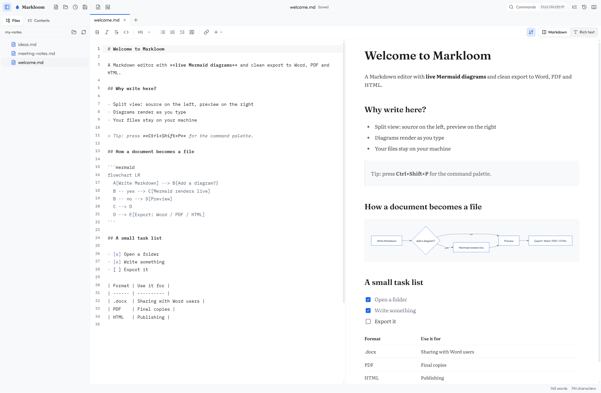
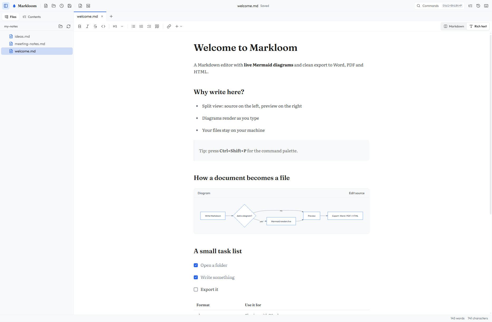
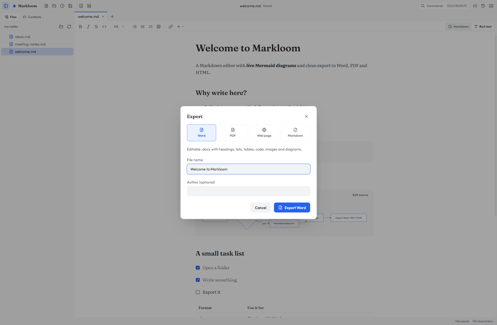
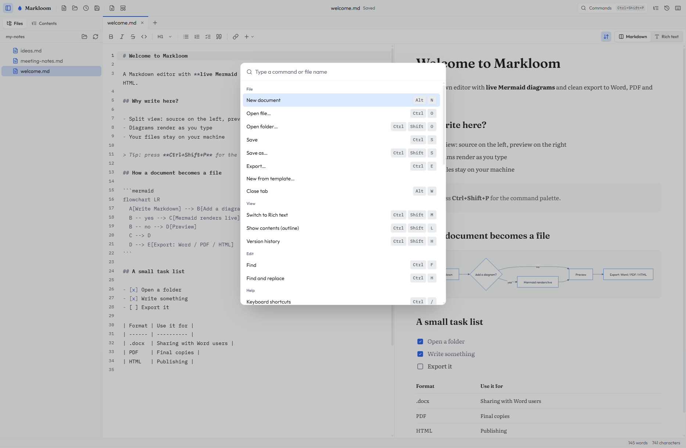

<div align="center">


**A Markdown editor with first-class Mermaid diagrams and clean export to Word, PDF and HTML.**
Runs in the browser or as a desktop app. Your documents never leave your machine.

[](https://github.com/boudou/Markloom/releases/latest)
[](https://github.com/boudou/Markloom/releases)
[](#download)
[](LICENSE)
<br>
[](https://github.com/boudou/Markloom/actions/workflows/ci.yml)
[](https://github.com/boudou/Markloom/actions/workflows/release.yml)
[](https://github.com/boudou/Markloom/commits/main)
[](CONTRIBUTING.md)

[Open in your browser](https://boudou.github.io/Markloom/) · [Download](#download) · [User manual](https://github.com/boudou/Markloom/wiki/User-Manual) · [Run from source](#run-from-source) · [Contributing](CONTRIBUTING.md)

</div>



## Features

- **Two editors**: split view (CodeMirror source plus live preview) or rich text (Milkdown) that keeps untouched Markdown byte-for-byte
- **Mermaid diagrams**: rendered live, with errors reported as "Line N: …" against your document
- **Math**: `$…$` and `$$…$$` typeset with KaTeX in the split-view preview and in PDF and HTML exports
- **Callouts**: GitHub-style `> [!NOTE]`, `[!TIP]`, `[!WARNING]` and friends render as coloured boxes, in the preview and in exports
- **Export**: Word (.docx), PDF, standalone HTML and portable Markdown, with diagrams and images embedded
- **Copy as rich text**: paste a document, or just the selection, formatted into email, Google Docs or Confluence, diagrams included
- **Multi-tab editing**, folder tree, document outline, recent files and session restore
- **Quick open** (`Ctrl+P`) to jump to any file in the open folder, and **search across files** (`Ctrl+Shift+F`) with results grouped by file and line
- **Find & replace** that works in both editors, plus a command palette (`Ctrl+Shift+P`)
- **Image drop and paste**: images are saved to `assets/` beside the document
- **Syntax highlighting** with a copy button on every code block, templates, version history, native spell check
- **Synced scrolling** between source and preview
- **Private by design**: no accounts, no uploads; Markdown is sanitized and Mermaid runs in strict mode

| Rich text editing | Export | Command palette |
| :---: | :---: | :---: |
|  |  |  |

## Download

**No install:** open the web version at **[boudou.github.io/Markloom](https://boudou.github.io/Markloom/)**. Your documents stay on your computer. Use Chrome or Edge to open and save files and folders. They can also install it as an app (the install icon in the address bar), and it opens offline after your first visit.

Or get the desktop app for your system from the [latest release](https://github.com/boudou/Markloom/releases/latest):

| System | File |
| --- | --- |
| Windows | `Markloom-Setup-<version>.exe` (installer) or `Markloom-<version>.exe` (portable, no install) |
| macOS (Apple silicon) | `Markloom-<version>-arm64.dmg` |
| Linux | `Markloom-<version>.AppImage` |

The installers are not code-signed yet ([#30](https://github.com/boudou/Markloom/issues/30)), so your system may warn you the first time:

- **Windows**: on the SmartScreen prompt, choose **More info → Run anyway**. If the message says **Smart App Control** blocked Markloom, there is no Run anyway: Windows 11 only runs unsigned apps it already knows, and it can't make an exception for one app. Until the builds are signed, use the [web version](https://boudou.github.io/Markloom/), turn Smart App Control off (**Windows Security → App & browser control → Smart App Control**), or [run Markloom from source](#run-from-source).
- **macOS**: open Markloom once; when macOS says it can't verify the developer, open **System Settings → Privacy & Security**, scroll down and click **Open Anyway** next to Markloom. If macOS says Markloom is *damaged* (builds up to 0.5.0), run `xattr -cr /Applications/Markloom.app` once.
- **Linux**: make the AppImage executable (`chmod +x Markloom-*.AppImage`), then run it.

## Quick tour

1. **Open a folder** (`Ctrl+Shift+O`) to browse your Markdown files in the sidebar, or **open a single file** (`Ctrl+O`). **New document** and **New from template** start from scratch.
2. **Write** in the Markdown editor with the live preview beside it. Switch to **Rich text** (`Ctrl+Shift+M`) to edit visually; only the parts you touch are rewritten, so your diffs stay small.
3. **Add a diagram** with a fenced `mermaid` block. It renders as you type, and syntax errors point to the exact line:

   ````markdown
   ```mermaid
   flowchart LR
     A[Write] --> B[Preview] --> C[Export]
   ```
   ````

4. **Add images** by dropping or pasting them. They are saved to an `assets/` folder next to the document.
5. **Find your way around**: `Ctrl+P` opens any file in the folder by name, `Ctrl+Shift+F` searches every file in it, `Ctrl+F` finds and `Ctrl+H` replaces in the current document, `Ctrl+Shift+L` shows the outline, and `Ctrl+Shift+H` opens version history.
6. **Export** (`Ctrl+E`) to Word, PDF, a standalone web page, portable Markdown or page images (PNG), or **Copy as rich text** (title bar or command palette) to paste it formatted into an email or another editor.
7. **Do anything from the keyboard**: `Ctrl+Shift+P` opens the command palette, and `Ctrl+/` lists every shortcut. On macOS, use `⌘` instead of `Ctrl`.

In the browser, new document and close tab are `Alt+N` and `Alt+W`, because the browser keeps `Ctrl+N` and `Ctrl+W` for itself.

The [user manual](https://github.com/boudou/Markloom/wiki/User-Manual) covers everything in more detail, and the [shortcut reference](https://github.com/boudou/Markloom/wiki/Keyboard-Shortcuts) lists every key.

## Run from source

You need [Node.js](https://nodejs.org/) 22.18 or newer, which includes npm, and [Git](https://git-scm.com/).

```bash
git clone https://github.com/boudou/Markloom.git
cd Markloom
npm install
```

### Web app

```bash
npm run dev             # opens http://localhost:1420
```

On Windows you can also double-click `start.bat`.

> **Browser support:** opening and saving files uses the File System Access API, so use Chrome, Edge or another Chromium-based browser. Firefox and Safari can write and export, but cannot open or save files. The desktop app has no such limit.

For an optimised production build:

```bash
npm run build           # type-check and build into dist/
npm run preview         # serve dist/ on http://localhost:4173
```

`dist/` is a static site, so you can host it on any static web server. The [hosted web version](https://boudou.github.io/Markloom/) is built this way by `.github/workflows/pages.yml` each time a release is published.

### Desktop app

```bash
npm run electron:dev    # desktop window with live reload
npm run electron:start  # build once, then run the desktop app
npm run electron:build  # build installers for your OS into release/
```

`electron:build` produces the installer for the system you run it on (an `.exe` on Windows, a `.dmg` on macOS, an `.AppImage` on Linux). On Windows, `start-desktop.bat` launches the packaged app, and `start-desktop.bat rebuild` rebuilds it first.

### End-to-end tests

The end-to-end tests in `e2e/` use [Playwright](https://playwright.dev/) and drive your installed Google Chrome, so there is no browser to download. They build the app, serve the build and run every test twice: in Markdown mode, and with the document opened straight into Rich text.

```bash
npm run test:e2e            # build, serve and run all tests headless
npm run test:e2e -- --ui    # pick and watch tests in Playwright's UI
```

The build is served on port 4173, and a second build with a test Google Analytics ID on port 5173; set `E2E_PORT` to move both (the second one is `E2E_PORT` + 1000). A test for a known gap is marked with the issue that tracks it and is expected to fail until that issue is fixed.

What the tests cover, one file per area:

| File | Area |
| --- | --- |
| `documents.spec.ts` | New document, open from the file tree, edit and save, closing with unsaved changes, tabs, Quick open, folder search, a file tree of documents only, recent files and folders on the start screen, session restore |
| `editing.spec.ts` | Toolbar formatting and its pressed state, find and replace, the command palette, focus mode, page width, smart typography |
| `rich-text.spec.ts` | Raw HTML in rich text (no Tab stops inside, its source survives the window losing focus); saving keeps untouched Markdown byte for byte |
| `parity.spec.ts` | Every construct renders in both editors: images, diagrams, tables, task lists, strikethrough, callouts, highlighted code, math, footnotes |
| `diagrams.spec.ts` | Mermaid renders and follows edits; an error names its document line and Show line goes there |
| `export.spec.ts` | Word, PDF (print stubbed), Web page, portable Markdown, Image (one page or a .zip), the preflight warnings, Copy as rich text |
| `settings.spec.ts` | The Settings window and each editor preference |
| `offline.spec.ts` | The service worker: the web version opens offline, and loads when its cache can't be written |
| `web.spec.ts` | Nothing loads from Google before the visitor allows usage statistics |

### Command reference

| Command | What it does |
| --- | --- |
| `npm run dev` | Web app with hot reload on port 1420 |
| `npm run build` | Type-check and production build into `dist/` |
| `npm run preview` | Serve the production build |
| `npm run lint` | Lint `src/` and `e2e/` with Oxlint and the anti-slop rules; type-check `e2e/` |
| `npm run test:e2e` | End-to-end tests against the production build, in both editors |
| `npm run electron:dev` | Desktop app with live reload |
| `npm run electron:start` | Build, then run the desktop app |
| `npm run electron:build` | Desktop installers in `release/` |

## Project structure

```
electron/          Desktop shell: app:// scheme, file access, PDF printing
e2e/               End-to-end tests (Playwright) and the test folder they open
src/
  components/      App shell, title bar, sidebar, status bar, UI primitives
  features/        One folder per feature: editor, export, mermaid, tabs, find-replace, …
  lib/             Markdown parser, document actions, shortcut table, session restore
  stores/          App, settings and UI state (Zustand)
docs/screenshots/  Images used in this README
```

[CONTRIBUTING.md](CONTRIBUTING.md) explains the conventions to follow.

## Contributing

Bug reports, ideas and pull requests are welcome. Start with [CONTRIBUTING.md](CONTRIBUTING.md), and please follow the [code of conduct](CODE_OF_CONDUCT.md).

- **Found a bug?** [Open a bug report](https://github.com/boudou/Markloom/issues/new?template=bug_report.md).
- **Have an idea?** [Suggest a feature](https://github.com/boudou/Markloom/issues/new?template=feature_request.md).
- **Want to help?** Planned work is tracked as [enhancement issues](https://github.com/boudou/Markloom/issues?q=is%3Aissue+is%3Aopen+label%3Aenhancement); comment on one to claim it.
- **Security issue?** Report it privately, as described in [SECURITY.md](SECURITY.md).

Changes are listed in the [changelog](CHANGELOG.md).

## Tech stack

React 18, TypeScript, Vite, Tailwind CSS with Radix UI, Zustand, CodeMirror 6, Milkdown, markdown-it, Mermaid, docx, Electron.

## Acknowledgements

Markloom's interactions are inspired by [interior](https://github.com/ddoemonn/interior) ([interior.dev](https://interior.dev)) by [@ddoemonn](https://github.com/ddoemonn): micro-interactions for React, "built for the half-second after a click". The sliding menu highlight, tooltip and dialog motion, the mode switch, and the copy and export buttons all build on its work. Thank you! Adapted code is credited in [THIRD_PARTY_NOTICES.md](THIRD_PARTY_NOTICES.md).

## License

[MIT](LICENSE) © [boudou](https://github.com/boudou)
