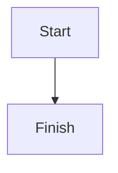

# Parity fixture

Every construct the parity spec checks, once each. Both editors must render all of them.

## Images


<picture>
<source srcset="assets/pic.png">

</picture>


<audio src="assets/tone.wav" controls></audio>

## Diagram



## Table

| Fruit | Colour |
| ----- | ------ |
| Lime  | Green  |

## Task list

- [x] Done task
- [ ] Open task

## Strikethrough

This is ~~struck out~~ text.

## Callout

> [!NOTE]
> Callout body text.

## Code

```js
const answer = 42;
```

## Math

Inline $a^2 + b^2 = c^2$ math.

$$
\int_0^1 x\,dx
$$

## Footnotes

A claim with a footnote.[^1]

[^1]: The footnote text.
