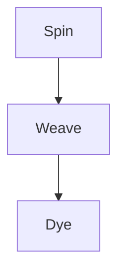

# Pages fixture

A document several pages long, for the export page layout: headings, prose, a table, code and a diagram.

## Section 1

Paragraph 1.1. Past kept the shuttles old looms grew the where every the bends weavers and of the their town moving mill through around river the winter sound past kept the shuttles old looms grew the where every the bends weavers and of the their town moving mill through around river the winter sound past kept the shuttles old looms grew the where every the bends weavers and of the their town.

Paragraph 1.2. The their town moving mill through around river the winter sound past kept the shuttles old looms grew the where every the bends weavers and of the their town moving mill through around river the winter sound past kept the shuttles old looms grew the where every the bends weavers and of the their town moving mill through around river the winter sound past kept the shuttles old looms grew.

Paragraph 1.3. Old looms grew the where every the bends weavers and of the their town moving mill through around river the winter sound past kept the shuttles old looms grew the where every the bends weavers and of the their town moving mill through around river the winter sound past kept the shuttles old looms grew the where every the bends weavers and of the their town moving mill through around.

Paragraph 1.4. Mill through around river the winter sound past kept the shuttles old looms grew the where every the bends weavers and of the their town moving mill through around river the winter sound past kept the shuttles old looms grew the where every the bends weavers and of the their town moving mill through around river the winter sound past kept the shuttles old looms grew the where every the.

Paragraph 1.5. Where every the bends weavers and of the their town moving mill through around river the winter sound past kept the shuttles old looms grew the where every the bends weavers and of the their town moving mill through around river the winter sound past kept the shuttles old looms grew the where every the bends weavers and of the their town moving mill through around river the winter sound.

## Section 2

Paragraph 2.1. Mill through around river the winter sound past kept the shuttles old looms grew the where every the bends weavers and of the their town moving mill through around river the winter sound past kept the shuttles old looms grew the where every the bends weavers and of the their town moving mill through around river the winter sound past kept the shuttles old looms grew the where every the.

Paragraph 2.2. Where every the bends weavers and of the their town moving mill through around river the winter sound past kept the shuttles old looms grew the where every the bends weavers and of the their town moving mill through around river the winter sound past kept the shuttles old looms grew the where every the bends weavers and of the their town moving mill through around river the winter sound.

Paragraph 2.3. The winter sound past kept the shuttles old looms grew the where every the bends weavers and of the their town moving mill through around river the winter sound past kept the shuttles old looms grew the where every the bends weavers and of the their town moving mill through around river the winter sound past kept the shuttles old looms grew the where every the bends weavers and of.

Paragraph 2.4. Weavers and of the their town moving mill through around river the winter sound past kept the shuttles old looms grew the where every the bends weavers and of the their town moving mill through around river the winter sound past kept the shuttles old looms grew the where every the bends weavers and of the their town moving mill through around river the winter sound past kept the shuttles.

Paragraph 2.5. Kept the shuttles old looms grew the where every the bends weavers and of the their town moving mill through around river the winter sound past kept the shuttles old looms grew the where every the bends weavers and of the their town moving mill through around river the winter sound past kept the shuttles old looms grew the where every the bends weavers and of the their town moving.

| Loom | Threads | Year |
| ---- | ------- | ---- |
| Loom 1 | 120 | 1807 |
| Loom 2 | 240 | 1814 |
| Loom 3 | 360 | 1821 |
| Loom 4 | 480 | 1828 |
| Loom 5 | 600 | 1835 |
| Loom 6 | 720 | 1842 |
| Loom 7 | 840 | 1849 |
| Loom 8 | 960 | 1856 |

## Section 3

Paragraph 3.1. Weavers and of the their town moving mill through around river the winter sound past kept the shuttles old looms grew the where every the bends weavers and of the their town moving mill through around river the winter sound past kept the shuttles old looms grew the where every the bends weavers and of the their town moving mill through around river the winter sound past kept the shuttles.

Paragraph 3.2. Kept the shuttles old looms grew the where every the bends weavers and of the their town moving mill through around river the winter sound past kept the shuttles old looms grew the where every the bends weavers and of the their town moving mill through around river the winter sound past kept the shuttles old looms grew the where every the bends weavers and of the their town moving.

Paragraph 3.3. Their town moving mill through around river the winter sound past kept the shuttles old looms grew the where every the bends weavers and of the their town moving mill through around river the winter sound past kept the shuttles old looms grew the where every the bends weavers and of the their town moving mill through around river the winter sound past kept the shuttles old looms grew the.

Paragraph 3.4. Looms grew the where every the bends weavers and of the their town moving mill through around river the winter sound past kept the shuttles old looms grew the where every the bends weavers and of the their town moving mill through around river the winter sound past kept the shuttles old looms grew the where every the bends weavers and of the their town moving mill through around river.

Paragraph 3.5. Through around river the winter sound past kept the shuttles old looms grew the where every the bends weavers and of the their town moving mill through around river the winter sound past kept the shuttles old looms grew the where every the bends weavers and of the their town moving mill through around river the winter sound past kept the shuttles old looms grew the where every the bends.

```js
function weave(threads) {
  threads.push('warp 1');
  threads.push('warp 2');
  threads.push('warp 3');
  threads.push('warp 4');
  threads.push('warp 5');
  threads.push('warp 6');
  threads.push('warp 7');
  threads.push('warp 8');
  threads.push('warp 9');
  threads.push('warp 10');
  threads.push('warp 11');
  threads.push('warp 12');
  return threads;
}
```

## Section 4

Paragraph 4.1. Looms grew the where every the bends weavers and of the their town moving mill through around river the winter sound past kept the shuttles old looms grew the where every the bends weavers and of the their town moving mill through around river the winter sound past kept the shuttles old looms grew the where every the bends weavers and of the their town moving mill through around river.

Paragraph 4.2. Through around river the winter sound past kept the shuttles old looms grew the where every the bends weavers and of the their town moving mill through around river the winter sound past kept the shuttles old looms grew the where every the bends weavers and of the their town moving mill through around river the winter sound past kept the shuttles old looms grew the where every the bends.

Paragraph 4.3. Every the bends weavers and of the their town moving mill through around river the winter sound past kept the shuttles old looms grew the where every the bends weavers and of the their town moving mill through around river the winter sound past kept the shuttles old looms grew the where every the bends weavers and of the their town moving mill through around river the winter sound past.

Paragraph 4.4. Winter sound past kept the shuttles old looms grew the where every the bends weavers and of the their town moving mill through around river the winter sound past kept the shuttles old looms grew the where every the bends weavers and of the their town moving mill through around river the winter sound past kept the shuttles old looms grew the where every the bends weavers and of the.

Paragraph 4.5. And of the their town moving mill through around river the winter sound past kept the shuttles old looms grew the where every the bends weavers and of the their town moving mill through around river the winter sound past kept the shuttles old looms grew the where every the bends weavers and of the their town moving mill through around river the winter sound past kept the shuttles old.



## Section 5

Paragraph 5.1. Winter sound past kept the shuttles old looms grew the where every the bends weavers and of the their town moving mill through around river the winter sound past kept the shuttles old looms grew the where every the bends weavers and of the their town moving mill through around river the winter sound past kept the shuttles old looms grew the where every the bends weavers and of the.

Paragraph 5.2. And of the their town moving mill through around river the winter sound past kept the shuttles old looms grew the where every the bends weavers and of the their town moving mill through around river the winter sound past kept the shuttles old looms grew the where every the bends weavers and of the their town moving mill through around river the winter sound past kept the shuttles old.

Paragraph 5.3. The shuttles old looms grew the where every the bends weavers and of the their town moving mill through around river the winter sound past kept the shuttles old looms grew the where every the bends weavers and of the their town moving mill through around river the winter sound past kept the shuttles old looms grew the where every the bends weavers and of the their town moving mill.

Paragraph 5.4. Town moving mill through around river the winter sound past kept the shuttles old looms grew the where every the bends weavers and of the their town moving mill through around river the winter sound past kept the shuttles old looms grew the where every the bends weavers and of the their town moving mill through around river the winter sound past kept the shuttles old looms grew the where.

Paragraph 5.5. Grew the where every the bends weavers and of the their town moving mill through around river the winter sound past kept the shuttles old looms grew the where every the bends weavers and of the their town moving mill through around river the winter sound past kept the shuttles old looms grew the where every the bends weavers and of the their town moving mill through around river the.

## Section 6

Paragraph 6.1. Town moving mill through around river the winter sound past kept the shuttles old looms grew the where every the bends weavers and of the their town moving mill through around river the winter sound past kept the shuttles old looms grew the where every the bends weavers and of the their town moving mill through around river the winter sound past kept the shuttles old looms grew the where.

Paragraph 6.2. Grew the where every the bends weavers and of the their town moving mill through around river the winter sound past kept the shuttles old looms grew the where every the bends weavers and of the their town moving mill through around river the winter sound past kept the shuttles old looms grew the where every the bends weavers and of the their town moving mill through around river the.

Paragraph 6.3. Around river the winter sound past kept the shuttles old looms grew the where every the bends weavers and of the their town moving mill through around river the winter sound past kept the shuttles old looms grew the where every the bends weavers and of the their town moving mill through around river the winter sound past kept the shuttles old looms grew the where every the bends weavers.

Paragraph 6.4. The bends weavers and of the their town moving mill through around river the winter sound past kept the shuttles old looms grew the where every the bends weavers and of the their town moving mill through around river the winter sound past kept the shuttles old looms grew the where every the bends weavers and of the their town moving mill through around river the winter sound past kept.

Paragraph 6.5. Sound past kept the shuttles old looms grew the where every the bends weavers and of the their town moving mill through around river the winter sound past kept the shuttles old looms grew the where every the bends weavers and of the their town moving mill through around river the winter sound past kept the shuttles old looms grew the where every the bends weavers and of the their.

The last paragraph of the fixture.
