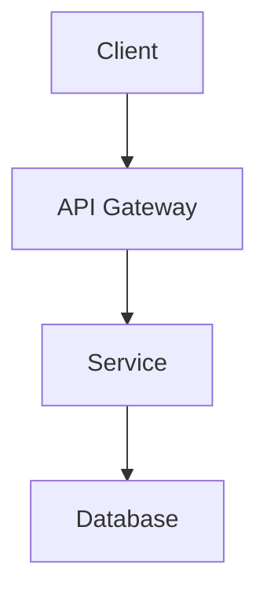
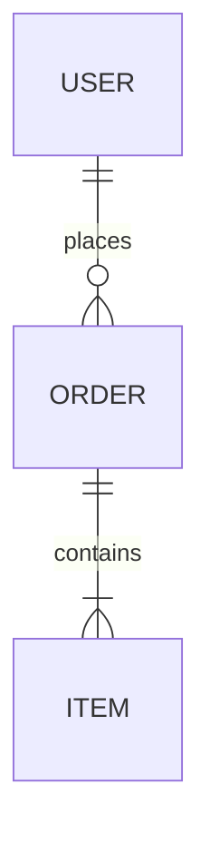

# Technical Specification

## Document Info

| Field | Value |
|-------|-------|
| Version | 1.0 |
| Date | {{date}} |
| Author | |
| Status | Draft |

## Overview

### Problem Statement

### Proposed Solution

## Architecture

### System Diagram

### Components

#### Component 1

#### Component 2

## Data Model

### Entity Relationship

## API Design

## Security Considerations

## Performance Requirements

## Testing Strategy

## Deployment Plan

## Open Questions

- [ ]
