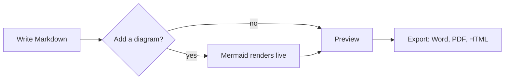

# A tour of Markloom

This document is plain Markdown, and it is yours to edit. Change anything and watch it update. Switch between **Markdown** and **Rich text** at the top right; both edit the same file.

> [!TIP]
> Press `Ctrl+Shift+P` to find any command, or `Ctrl+E` to export this page to Word, PDF or a web page.

## Diagrams that render as you type

Change a label below, or break the syntax on purpose: the error names the line.



## Export for people who don't use Markdown

| Format | Good for | Diagrams |
| --- | --- | --- |
| Word (.docx) | Reviews and shared editing | Embedded as images |
| PDF | Final copies | Embedded as vector graphics |
| Web page | Publishing a single file | Embedded as vector graphics |
| Copy as rich text | Email, Google Docs, Confluence | Pasted as images |

## Rich text that respects your file

- [x] Edit visually, with no Markdown on screen
- [x] Untouched blocks stay exactly as you wrote them, so diffs stay small
- [ ] Save this tour somewhere, or close it and start your own

## The rest of what you can write

Code is highlighted in both editors:

```python
def weave(threads: list[str]) -> str:
    return " + ".join(threads)
```

Math is typeset: $E = mc^2$, or on its own line:

$$
\sum_{n=1}^{\infty} \frac{1}{n^2} = \frac{\pi^2}{6}
$$

Footnotes link to their notes at the end.[^1]

[^1]: This is one. Your documents stay on your computer: there are no accounts and no uploads.
